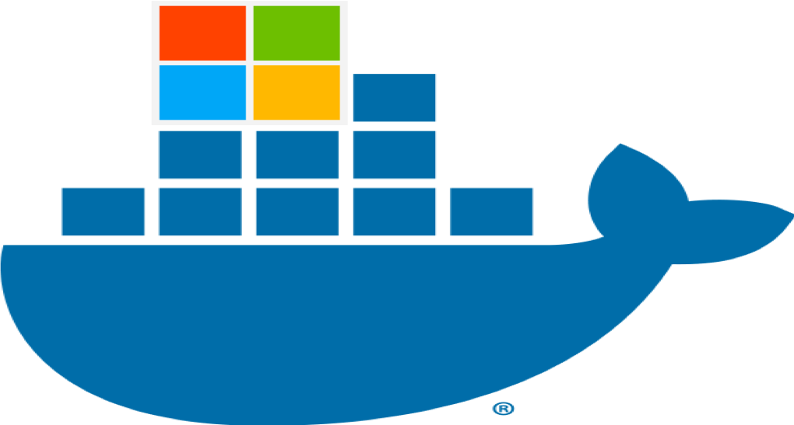

# M365 Admin PowerShell Container



Ephemeral, dockerized PowerShell 7 environment pre-loaded with Microsoft 365 / Entra ID admin modules. Each run is a fresh container — no persisted state, no cached tokens, reauthenticate every time.

## About

 If you've ever burned 10+ minutes on a fresh machine running Install-Module six times over before you can actually start troubleshooting a tenant, this might save you some pain.

What it is: A small Docker Compose setup that gives you a PowerShell 7 container pre-loaded with the modules most M365/Entra admins reach for regularly; Microsoft Graph, Exchange Online Management, PnP PowerShell, Microsoft Teams, Power Platform admin, Az, and Microsoft365DSC. Build once, then spin up a clean, fully-loaded shell in seconds.

Why it exists: I got tired of re-installing the same stack of modules across different machines (and re-solving the same "why won't this module cooperate with that PowerShell version" issues) every time I needed to do tenant admin work from somewhere new. Building it into a container fixed that permanently.

Why you might want it:

- Zero manual setup - clone, docker compose run, done. No hunting down module versions or fighting dependency conflicts on your host.

- Ephemeral by design - every run (docker compose run --rm) is a brand new container. No leftover tokens, no state drift, no "wait, why is this module version different than last week." Reauthenticate fresh every session.

- Portable - works identically on Linux, and anywhere else Docker runs. No more "works on my machine."

- Reproducible - the whole environment is defined in one Dockerfile. Anyone on your team gets the exact same toolset, every time.

- Browser-based auth support - includes a workaround for interactive sign-in from inside a container (useful if your org blocks device code flow, which more and more are doing given the recent wave of device-code phishing attacks).

- Not trying to reinvent anything - it's a thin wrapper around tools you already know. Just removes the "reinstall everything, again" tax every time you need a clean environment. 

## What's included

- **PowerShell 7** (via `mcr.microsoft.com/dotnet/sdk:9.0`)
- **Microsoft.Graph** / **Microsoft.Graph.Beta** — Entra ID, users, groups, Conditional Access
- **ExchangeOnlineManagement** — Exchange Online + Security & Compliance Center
- **PnP.PowerShell** — SharePoint Online, Teams, M365 Groups
- **MicrosoftTeams** — Teams-specific admin
- **Microsoft.PowerApps.*** — Power Platform admin
- **Az** — Azure resource management
- **Microsoft365DSC** — configuration auditing / drift detection
- A stub `xdg-open` that prints the sign-in URL to the terminal instead of trying to launch a browser, since the container has none

## Requirements

- Docker + Docker Compose
- A host browser to complete interactive sign-in (URL is copy-pasted manually)

## Build

```bash
docker compose build
```

Rebuild whenever you want to refresh module versions:

```bash
docker compose build --no-cache
```

## Run

```bash
docker compose run --rm m365-admin
```

Drops you into an interactive `pwsh` shell. `--rm` deletes the container on exit — nothing persists between runs.

## Authenticating

Browser-based interactive auth is used. When you connect to a service, the stub `xdg-open` prints a URL instead of opening a browser:

```powershell
Connect-ExchangeOnline
```

Copy the printed URL into your host browser, sign in, and the OAuth redirect will complete back into the container.

## Networking note

The compose file uses `network_mode: host` so the container shares your host's `localhost`, letting the OAuth loopback redirect (`http://localhost:PORT/...`) reach the container's local auth listener without port-mapping guesswork.

## Files

| File | Purpose |
|---|---|
| `Dockerfile` | Builds the image: PowerShell + modules + `xdg-open` stub |
| `docker-compose.yml` | Runs the container interactively with host networking |

## Notes

- Modules are baked into the docker image at `docker build` time - rebuilding the image again refreshes / updates the modules to latest.
- No credentials, tokens, or module state persist across runs by design.
